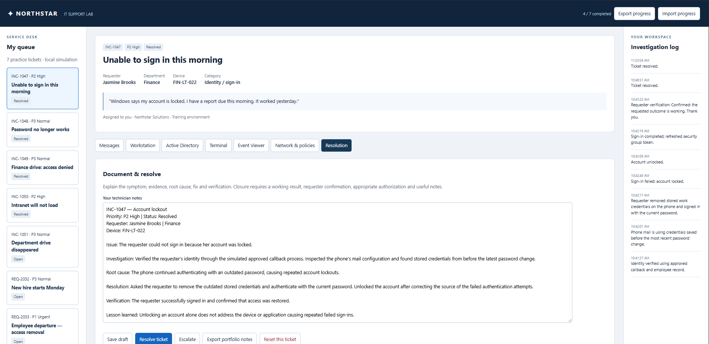
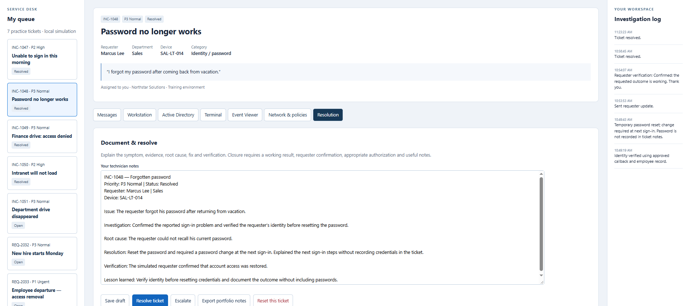
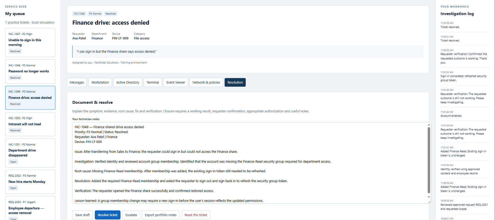
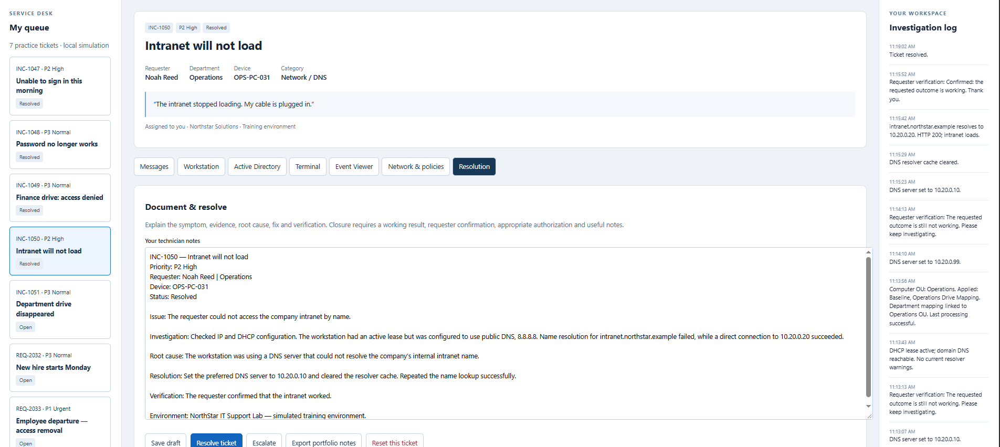

# Northstar IT Support Lab

A personal learning project documenting my return to IT through simulated help desk troubleshooting and Active Directory administration concepts.

**Progress: 4 of 7 scenarios completed — October 5, 2026.**

All users, devices and administrative actions are fictional. This project documents simulator practice, not production administration or a deployed Windows Server domain. The simulator was created with assistance from OpenAI Codex; I performed the documented troubleshooting exercises.

## Completed work

| Ticket | Problem | Resolution practiced | Report |
|---|---|---|---|
| INC-1047 | Repeated account lockout | Verified identity, corrected stale phone credentials and unlocked the account | [Read report](tickets/INC-1047.md) |
| INC-1048 | Forgotten password | Verified identity, reset password and required change at next sign-in | [Read report](tickets/INC-1048.md) |
| INC-1049 | Finance share access denied | Added Finance-Read membership and refreshed the sign-in token | [Read report](tickets/INC-1049.md) |
| INC-1050 | Intranet name resolution failure | Compared hostname and IP connectivity, restored internal DNS and cleared resolver cache | [Read report](tickets/INC-1050.md) |

Reports include my saved technician notes and the simulator's recorded action history, including unsuccessful attempts. These show the investigation process rather than only the final fix.

## What I learned

- Correct the source of repeated failed authentication before unlocking an account.
- Verify requester identity before resetting credentials; keep passwords out of ticket notes.
- Group membership changes may require a refreshed sign-in token before access works.
- Successful connectivity by IP combined with failed hostname resolution is evidence to investigate DNS.
- Confirm the requested outcome with the requester before closing a ticket.

## Screenshots

### Account lockout — resolved

### Forgotten password — resolved

### Finance share — resolved

### DNS — resolved
This screenshot shows the resolved ticket, successful name resolution and requester confirmation.

## Try the simulator locally

1. Download this repository using **Code → Download ZIP** and extract it.
2. Open `simulator/Northstar IT Lab.html` in Edge or Chrome, or double-click `simulator/Launch.cmd`.
3. Start a fresh exercise, or choose **Import progress** and select `progress/northstar-progress.json` to inspect my completed work.

No GPT account, internet connection, installation or server is required after download. GitHub displays the source; it does not run the simulator directly from the repository file view.

The terminals and administrative interfaces are limited simulations. Calls are scripted transcripts. See [the simulator documentation](simulator/README.md) for limitations and development instructions.

## Next steps

- Complete the Group Policy, onboarding and offboarding scenarios.
- Practice these concepts in a Windows Server and Windows client virtual machine lab.

## Repository contents

- `tickets/`: four completed resolution reports and recorded action histories.
- `screenshots/`: screenshots captured during the exercises.
- `progress/`: simulator progress backup containing four resolved and three open tickets.
- `simulator/`: offline app and editable source files.

